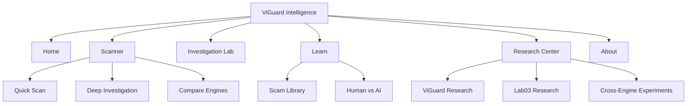
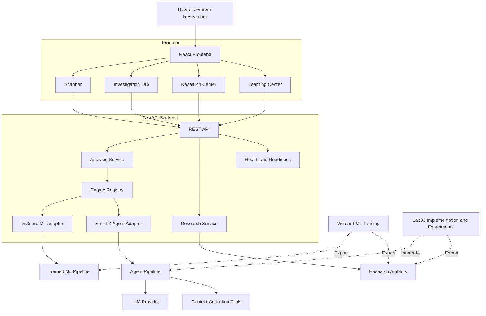
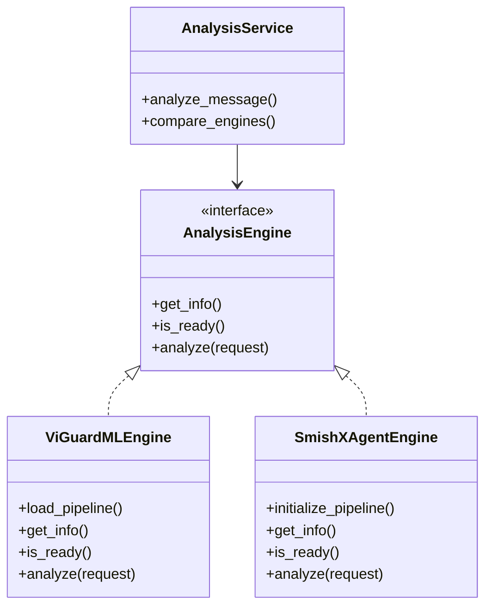
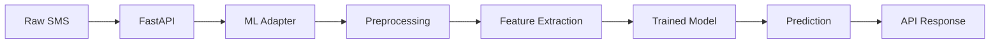
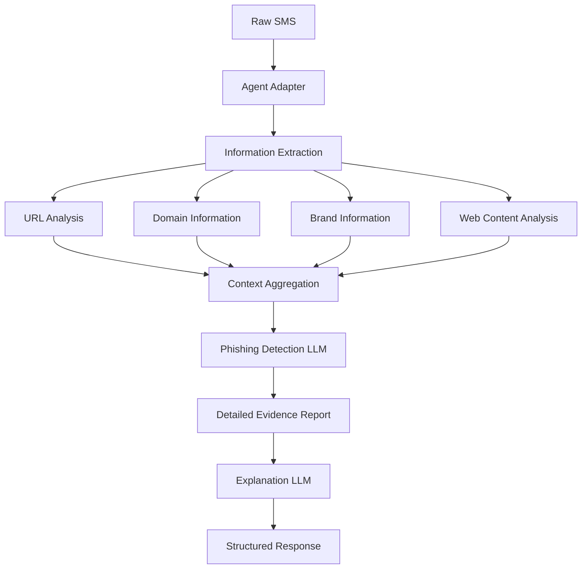
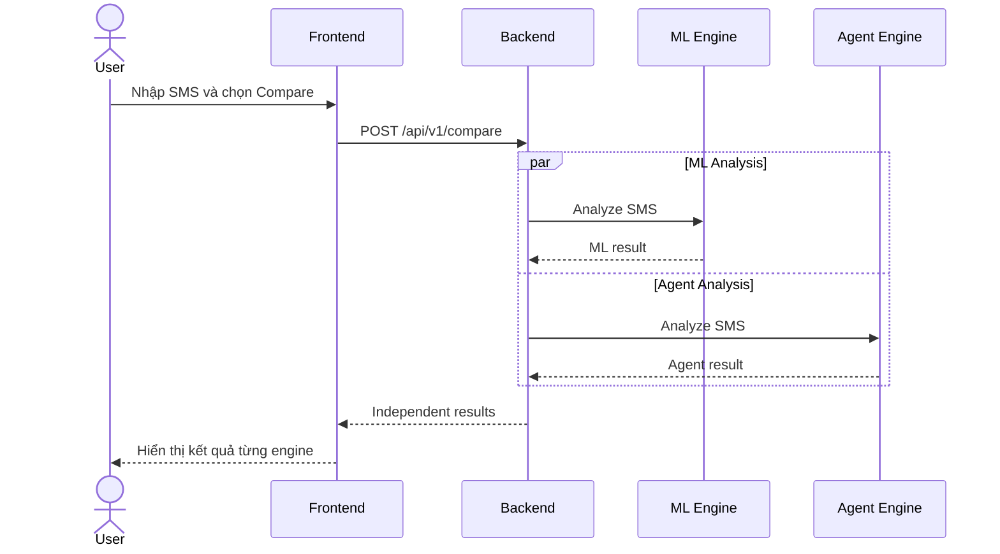
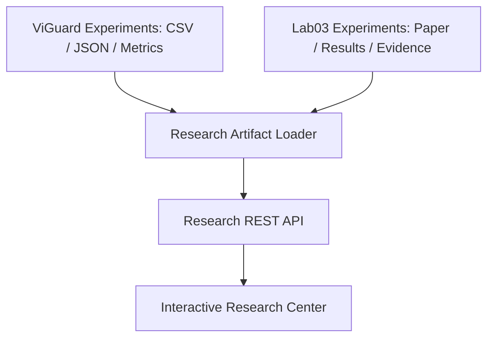
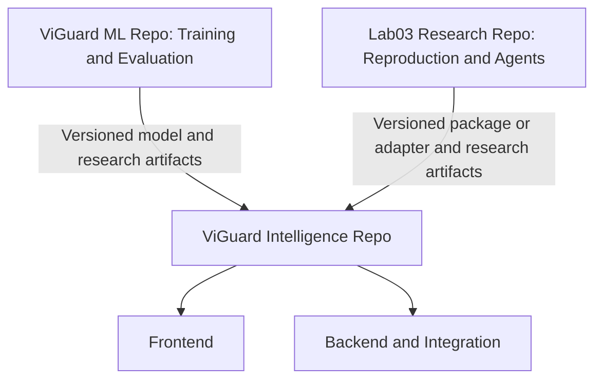
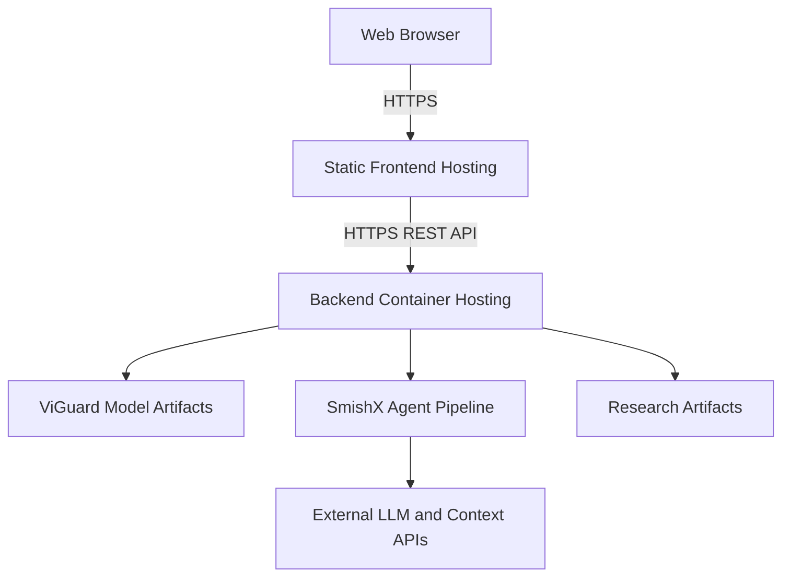

# VIGUARD INTELLIGENCE — MASTER PLAN

> **Phiên bản:** 1.1 · **Ngày:** 25/11/2026  
> **Trạng thái:** Định hướng tổng thể v1.0 đã được người dùng đồng ý; v1.1 bổ sung Creative Frontend & Motion theo yêu cầu mới. Chưa triển khai hoặc kiểm thử website.  
> **Phạm vi:** Một website chung cho đồ án ViGuard và Lab03 Machine Learning Research.  
> **Mục đích tài liệu:** Theo dõi tiến độ, định hướng thiết kế, làm nguồn tham chiếu cho nhóm và AI coding agent.

---

## Thay đổi v1.1 so với v1.0

- Giữ nguyên một website, hai engine độc lập, ranh giới nghiên cứu, API, kiến trúc backend và ML integration.
- Nâng chất lượng frontend thành yêu cầu cốt lõi: cinematic landing, cursor-reactive background, micro-interactions, shared layout, motion tokens và signature animations.
- Thêm đặc tả theo từng trang, chiến lược chọn thư viện, thử nghiệm hero, Motion Playground, performance/accessibility gates, review bằng trình duyệt thật.
- Chèn Phase 1.5 sau frontend bootstrap tối thiểu, trước triển khai các trang production; cập nhật MVP, checklist, quyết định và blockers.
- React Bits/GSAP là công cụ chọn lọc, không phải lý do cài hàng loạt dependency. Các thông số motion và ngân sách dưới đây là mục tiêu thiết kế đề xuất, chưa có benchmark thực tế.
- File này thay thế Master Plan v1.0; không phải phụ lục rời. Không có phase triển khai mới nào được đánh dấu hoàn thành.

## Mục lục

1. [Product Vision](#1-product-vision)
2. [Điểm sáng tạo](#2-điểm-sáng-tạo)
3. [Information Architecture](#3-information-architecture)
4. [Thiết kế từng trang](#4-thiết-kế-từng-trang)
5. [UIUX Design System](#5-uiux-design-system)
6. [System Architecture](#6-system-architecture)
7. [Tech Stack](#7-tech-stack)
8. [ML Integration](#8-ml-integration)
9. [API Contract](#9-api-contract)
10. [Research Artifacts](#10-research-artifacts)
11. [Repository Structure](#11-repository-structure)
12. [Infrastructure, Deployment, Security](#12-infrastructure-deployment-security)
13. [Frontend Skills](#13-frontend-skills)
14. [Roadmap](#14-roadmap)
15. [MVP Scope](#15-mvp-scope)
16. [Academic Requirements](#16-academic-requirements)
17. [Definition of Done](#17-definition-of-done)
18. [Decision Summary](#18-decision-summary)
19. [Next Steps and Open Decisions](#19-next-steps-and-open-decisions)

## 1. Product Vision

**Tên sản phẩm:** ViGuard Intelligence  
**Tagline:** Understand the message. Uncover the threat.  
**Thông điệp tiếng Việt:** Hiểu tin nhắn. Nhận diện nguy cơ.  
**Concept:** Research-backed AI Security Platform — nền tảng bảo mật ứng dụng AI được hậu thuẫn bằng nghiên cứu khoa học.

### 1.1. Mục tiêu

Xây dựng một website thống nhất, có bản sắc thiết kế riêng, dùng được như một sản phẩm thực tế, đồng thời hỗ trợ giảng viên khám phá toàn bộ quá trình nghiên cứu, triển khai và đánh giá hai đồ án.

- **ViGuard ML Engine:** phân loại SMS tiếng Việt bằng pipeline ML/NLP của nhóm; ba nhãn Safe, Advertisement, Scam.
- **SmishX Agent Engine:** tái hiện phương pháp LLM-based Agents của paper Lab03, tập trung vào thu thập ngữ cảnh, phát hiện phishing và giải thích dựa trên bằng chứng.
- Hai engine độc lập; không buộc dùng chung model, taxonomy, dataset hay quy trình đánh giá.
- Một website, một design system, một frontend và một backend ứng dụng. Các pipeline nghiên cứu được phát triển độc lập và tích hợp sau.
- Dùng chung nền tảng phần mềm không đồng nghĩa gộp hai bài nộp, kết quả, quyền tác giả hoặc tiêu chí đánh giá. Cần giữ rõ phần đóng góp của từng đồ án.

### 1.2. Đối tượng sử dụng

| Đối tượng | Nhu cầu |
|---|---|
| Người dùng phổ thông | Kiểm tra SMS và nhận khuyến nghị an toàn dễ hiểu |
| Người am hiểu công nghệ | Điều tra chuyên sâu, kiểm tra bằng chứng và so sánh engine |
| Giảng viên, sinh viên | Khám phá dataset, phương pháp, code, kết quả thực nghiệm và đóng góp |

### 1.3. Ba lớp trải nghiệm

| Lớp | Mục tiêu | Thành phần |
|---|---|---|
| Protect | Bảo vệ người dùng | Scanner, kết quả phân loại, khuyến nghị |
| Investigate | Khám phá quá trình phân tích | Agent pipeline, evidence inspector, engine comparison |
| Research | Thể hiện chiều sâu khoa học | Interactive paper, EDA, experiments, error analysis |

Không xây một dashboard quản trị đại trà, một báo cáo PDF được chuyển nguyên văn lên web, hoặc một textbox đơn giản chỉ có nút Predict.

### 1.4. Creative Frontend Vision

Website phải có cảm giác được thiết kế thủ công bởi Design Engineer: tương tác tức thời, chuyển động tự nhiên, bố cục có bản sắc, chi tiết được tinh chỉnh qua trình duyệt thật. Home mang trải nghiệm như một đoạn phim giới thiệu sản phẩm có thể tương tác; Scanner, Investigation và Research giữ hiệu suất và khả năng đọc. Cảm giác cao cấp đến từ choreography, art direction và tính nhất quán, không phải số lượng animation. Người dùng có thể di chuột để tác động nhẹ lên background, chuyển tab và chuyển trang liên tục không giật, mở evidence panel mà không mất ngữ cảnh. Mọi hiệu ứng đều có fallback; chức năng và thông tin không phụ thuộc animation.

## 2. Điểm sáng tạo

### 2.1. Dual-Engine Analysis

Người dùng nhập cùng một SMS và lựa chọn:

- **Quick Scan:** ViGuard ML Engine.
- **Deep Investigation:** SmishX Agent Engine.
- **Compare Engines:** chạy hai engine độc lập, hiển thị kết quả cạnh nhau.

| Khả năng | ML Engine | Agent Engine |
|---|---|---|
| Phân tích nội dung SMS | Có | Có |
| Pipeline đã huấn luyện | Có | Không bắt buộc |
| Ngữ cảnh bên ngoài | Theo feature thực tế | Theo phương pháp paper |
| Giải thích | Nếu có XAI phù hợp; dấu hiệu rule-based phải ghi rõ | Dựa trên kết quả phân tích và bằng chứng |
| Latency, chi phí | Đo thực tế | Đo thực tế |
| Hoạt động offline | Có thể, tùy model | Tùy LLM provider và tools |

Hiển thị nhãn gốc, phiên bản engine, trạng thái, thời gian xử lý và các score nếu thực sự có. Không mặc định Agent Engine chính xác hơn ML Engine; không tự tổng hợp thành một kết luận chung khi chưa có phương pháp được kiểm chứng.

### 2.2. Evidence Explorer

Trình bày thông tin đã thu thập, nguồn, thời điểm nếu có, trạng thái xác minh và giới hạn của bằng chứng. Các nhóm bằng chứng có thể gồm:

| Nhóm | Nội dung |
|---|---|
| SMS content | Dấu hiệu từ nội dung văn bản |
| Brand | Thương hiệu được đề cập và kết quả đối chiếu |
| URL | URL trích xuất, thông tin chuyển hướng nếu thu thập được |
| Domain | Thông tin tên miền, lịch sử đăng ký nếu có |
| Web context | Tóm tắt HTML hoặc ảnh chụp đã xử lý an toàn nếu triển khai |

Phân biệt `verified`, `unverified`, `unavailable`, `failed`, `not_applicable` (tên trạng thái đề xuất). Một tool gọi thành công không tự động chứng minh một nhận định là đúng. Không hiển thị private chain-of-thought; chỉ hiển thị execution trace, tool outputs, bằng chứng và tóm tắt giải thích được phép công bố.

Đóng góp ứng dụng dự kiến: minh bạch hóa trạng thái bằng chứng, giúp người dùng nhận ra khi AI thiếu dữ liệu hoặc có thể sai. Cần kiểm chứng thay vì tuyên bố hiệu quả chưa đo.

### 2.3. Interactive Research

Chuyển nghiên cứu thành các trải nghiệm đọc hiểu trực quan: dataset explorer, EDA, feature engineering, mô hình, training/evaluation pipeline, ablation study, confusion matrix, error analysis, reproduction, limitations và reproducibility. Phân biệt rõ số liệu paper gốc và số liệu nhóm.

### 2.4. Human vs AI

Người dùng đánh giá SMS mẫu trước khi xem kết quả/giải thích, sau đó đánh giá lại và nhận phản hồi giáo dục. Dùng mẫu đã kiểm duyệt, không hiển thị link nguy hiểm có thể nhấp. Không biến kết quả tương tác minh họa thành số liệu user study thực tế.

Phương pháp before/after đã được paper SmishX thực hiện (Section 5.1, Figure 3); đây là phần tái hiện/lấy cảm hứng, không phải phát minh mới. Nếu nhóm tổ chức user study riêng, cần quy trình và sự đồng ý của người tham gia phù hợp.

### 2.5. Đo lường giá trị đóng góp

So sánh giao diện chỉ đưa ra nhãn/giải thích văn bản với Evidence Explorer có nguồn và trạng thái xác minh. Chọn trước tiêu chí như task success rate, thời gian hoàn thành, tỷ lệ chấp nhận kết quả AI sai, phản hồi người dùng. Đối với engine comparison, đo latency, chi phí và metrics chỉ khi điều kiện so sánh phù hợp. Đây là giả thuyết và kế hoạch đo, chưa phải kết quả.

### 2.6. Signature Creative Experience

| Signature | Ý tưởng | Điều kiện trung thực |
|---|---|---|
| Signal Field | Lưới dữ liệu phản ứng với con trỏ ở Hero | Trang trí, không biểu thị threat telemetry thật |
| Signal Scan | Dải quét SMS khi request đang chạy | Không hiển thị phần trăm hoặc tiến trình giả |
| Message Deconstruction | SMS minh họa tách thành thực thể và dấu hiệu | Chỉ dùng mẫu được duyệt, ghi rõ minh họa |
| Dual Intelligence | Một luồng SMS tách thành hai engine | Hai kết quả độc lập, không giả lập ensemble |
| Evidence Flow / Constellation | Node kết nối thực thể, tool và evidence | Live chỉ dùng evidence/trace có thật; demo ghi nhãn riêng |

Đây là điểm khác biệt về trải nghiệm và nhận diện thương hiệu; không tự xem là đóng góp ML mới hoặc lợi ích đã đo lường.

## 3. Information Architecture



| Trang | Route đề xuất | Mục đích | Ưu tiên |
|---|---|---|---|
| Home | `/` | Thương hiệu, câu chuyện, dẫn vào Scanner | P0 |
| Scanner | `/scanner` | Kiểm tra SMS bằng một hoặc hai engine | P0 |
| Investigation Lab | `/investigation` | Agent workflow và evidence inspector | P0 |
| Research Center | `/research` | Hai khu vực nghiên cứu độc lập | P0 |
| Learn | `/learn` | Giáo dục, thư viện, quiz | P1 |
| About | `/about` | Nhóm, đóng góp, nguồn tham khảo | P1 |

Các route con như `/research/viguard` và `/research/lab03` tổ chức nội dung riêng. Cross-engine experiments chỉ hiển thị kết quả so sánh định lượng khi đủ điều kiện.

## 4. Thiết kế từng trang

### 4.1. Home

Phong cách landing page công nghệ cao cấp, bố cục editorial, không giống dashboard quản trị. Các section:

| Section | Nội dung |
|---|---|
| Navigation | Logo, Scanner, Investigation, Learn, Research |
| Hero | Tagline, CTA kiểm tra SMS, visual đặc trưng của ViGuard |
| Problem Story | Vấn đề lừa đảo và khó khăn khi nhận diện SMS |
| Dual AI Engines | Giới thiệu hai phương pháp và sự khác biệt |
| Interactive Preview | Minh họa trải nghiệm Scanner, ghi rõ demo |
| Research Highlights | Kết quả đã xác nhận, ghi rõ nguồn |
| How It Works | Workflow chung |
| Privacy & Trust | Quyền riêng tư, giới hạn AI |
| CTA & Footer | Bắt đầu kiểm tra, nhóm, paper, GitHub, references |

Hero ưu tiên graphic riêng (ví dụ luồng dữ liệu từ SMS đến bằng chứng), tránh ổ khóa 3D, gradient tím và các visual AI đại trà. Dùng một **immersive hero** làm điểm nhấn: nền midnight, chữ lớn dễ đọc, điểm dữ liệu cyan phản ứng với chuột, CTA rõ ràng. Home có thể chuyển từ dark hero sang light editorial research; dùng chung tokens để không cảm giác hai website ghép lại.

#### 4.1.1. Storyboard chuyển động của Home

| Scene | Nội dung và choreography | Tương tác / công nghệ đề xuất |
|---|---|---|
| 01 — Immersive Hero | Tiêu đề xuất hiện theo dòng; visual Signal Field phản ứng nhẹ theo vị trí chuột; CTA nổi bật | CSS/SVG hoặc React Bits Dot Grid đã tùy chỉnh; Motion cho reveal, spotlight và CTA |
| 02 — Message Deconstruction | Một SMS mẫu chuyển từ khối văn bản thành các dấu hiệu/URL/thực thể, giải thích rõ đây là minh họa | Motion layout/SVG; scroll reveal một lần, không che chữ |
| 03 — Dual Intelligence | Luồng dữ liệu tách thành ML Engine và Agent Engine; hai nhánh hiển thị vai trò riêng | SVG path + Motion; GSAP ScrollTrigger nếu choreography nhiều bước thật sự cần |
| 04 — Evidence Constellation | Node xuất hiện có liên hệ với SMS và evidence; hover/focus làm rõ từng node | SVG hoặc React Flow nếu cần tương tác graph; fallback danh sách có ngữ nghĩa |
| 05 — Science Behind Intelligence | Chuyển sang nền sáng, giới thiệu paper/EDA/experiments với nguồn rõ ràng | Chart transition nhẹ, Motion; không giả số liệu |
| 06 — Privacy & CTA | Kết thúc bằng cam kết quyền riêng tư, giới hạn AI và nút kiểm tra SMS | Motion reveal tinh tế; CTA hoạt động ngay |

Không tự động phát video nền nặng hoặc âm thanh; không khóa cuộn trang, không scroll hijacking. Nội dung phải đọc được trước khi JS creative effects sẵn sàng. Trên màn hình nhỏ, thay pin/parallax nhiều lớp bằng section cuộn bình thường. CTA không cần chờ animation kết thúc mới bấm được.

#### 4.1.2. Ba concept hero cần prototype trước khi chọn

| Concept | Art direction | Kỹ thuật | Trade-off cần kiểm tra |
|---|---|---|---|
| A — Signal Field (ưu tiên mặc định) | Lưới tín hiệu và spotlight phản ứng với chuột, typography editorial | CSS radial gradient + SVG/Canvas 2D hoặc React Bits Dot Grid | Đọc rõ headline, phản hồi chuột mượt, nền không lấn át nội dung |
| B — Evidence Constellation | Mạng node và liên kết quanh SMS, chuyển động có chiều sâu | SVG + Motion, hover/focus highlight | Ngữ nghĩa dễ hiểu; tránh mạng node quá rối |
| C — Liquid Intelligence | Ánh sáng mềm và shader/fluid mang tính trừu tượng | React Bits shader đã kiểm tra hoặc CSS fallback | GPU, pin, mobile, tương phản; loại nếu nặng hoặc thiếu liên hệ bài toán |

Ba concept là prototype ngắn, cùng nội dung, cùng CTA để so sánh công bằng; chỉ chọn **một** hero production. Tiêu chí: bản sắc 30%, interaction/motion 25%, readability/usability 20%, performance 15%, accessibility/mobile 10% (trọng số review nội bộ đề xuất, không phải rubric môn học). Không triển khai cả ba vào sản phẩm.

### 4.2. Scanner

Wireframe desktop (minh họa bố cục):

```text
┌────────────────────────────────────────────────────────────────────┐
│ ViGuard.        Scanner     Investigation     Learn     Research  │
├────────────────────────────────────────────────────────────────────┤
│ Check a message.                                                   │
│ Understand the risks before taking action.                         │
│ ┌────────────────────────────┐  ┌───────────────────────────────┐ │
│ │ SMS input                  │  │ Analysis result               │ │
│ │ [Paste message here]       │  │ Classification / engine       │ │
│ │ Sample messages            │  │ Indicators / evidence         │ │
│ │ Quick | Deep | Compare     │  │ Recommended actions           │ │
│ │ [Analyze message]          │  │ View technical details        │ │
│ └────────────────────────────┘  └───────────────────────────────┘ │
└────────────────────────────────────────────────────────────────────┘
```

- Mobile: input ở trên, kết quả bên dưới; thao tác dán SMS dễ dàng.
- Kết quả hiển thị theo progressive disclosure: nhãn và hành động an toàn trước, chi tiết kỹ thuật sau.
- Compare mode: hai kết quả song song trên desktop, xếp dọc trên mobile. Giữ nhãn gốc và lưu ý taxonomy.
- Hỗ trợ empty input, validation, loading, success, partial, timeout, error, not-ready. Không mất kết quả engine đã hoàn thành nếu engine còn lại lỗi.
- Không render URL đáng ngờ thành hyperlink, không khẳng định SMS an toàn tuyệt đối.

#### 4.2.1. Motion choreography của Scanner

- Tab Quick/Deep/Compare dùng shared-layout indicator trượt; nội dung fade + dịch 4–8 px theo hướng chuyển, giữ input và focus, không mất SMS khi đổi mode.
- Textarea focus ring rõ, sample message điền ngay; không typewriter delay khi dán văn bản.
- Analyze button có hover/press, chuyển sang loading không đổi chiều rộng, disable duplicate submit; timeout và retry rõ ràng.
- Signal Scan chỉ chạy trong request thật; nếu không có progress, dùng trạng thái indeterminate. Request kết thúc thì dừng scan ngay; nếu not-ready hiển thị thông báo thay vì giả chạy.
- Result xuất hiện theo thứ tự: kết luận → khuyến nghị → chi tiết; không trì hoãn việc đọc kết luận vì hiệu ứng. Khi compare, giữ kết quả đã xong nếu engine kia còn chạy/lỗi.
- Evidence accordion/drawer chuyển layout mềm, keyboard/focus đúng; score, chart, label lấy từ response thực, không animate từ 0 qua các giá trị có thể gây hiểu nhầm.

### 4.3. Investigation Lab

Không gian làm việc chuyên sâu, phong cách dark workspace. Ba cột trên desktop:

```text
┌──────────────────────┬───────────────────────────────┬──────────────────────┐
│ CASE INPUT           │ EXECUTION TRACE               │ EVIDENCE INSPECTOR   │
│ SMS text             │ Information Extraction        │ Brand                │
│ Sample cases         │         ↓                     │ URL                  │
│ Run analysis         │ Context Collection            │ Domain               │
│ Engine / run ID      │         ↓                     │ Redirect chain       │
│ Duration             │ Detection LLM                 │ HTML / visual        │
│                      │         ↓                     │ Assessment           │
│                      │ Explanation LLM               │ Advice / warnings    │
└──────────────────────┴───────────────────────────────┴──────────────────────┘
```

| Module | Chức năng |
|---|---|
| Case Input | SMS, mẫu thử, thông tin lần chạy |
| Pipeline Visualizer | Sơ đồ tương tác, input/output của từng bước |
| Execution Trace | Pending/running/completed/failed/skipped, latency thực tế |
| Evidence Inspector | Bằng chứng, nguồn, trạng thái, giới hạn |
| Decision Panel | Kết quả, giải thích, khuyến nghị |
| Technical Details | Output kỹ thuật đã lọc thông tin nhạy cảm |

Responsive: chuyển thành các panel/tab hoặc accordion trên màn hình nhỏ. Animation chỉ phản ánh tiến trình thực tế, không mô phỏng một agent đang chạy khi chưa kết nối.

#### 4.3.1. Motion choreography của Investigation

- Pipeline visualizer có node states: pending, running, completed, failed, skipped. Edge highlight hoặc data pulse chỉ kích hoạt với sự kiện phù hợp; không chạy timeline giả theo timer.
- Click node mở inspector với layout transition, giữ vị trí graph và trạng thái chọn; evidence item mở rộng hoặc chuyển thành drawer trên mobile.
- Nếu backend chỉ trả response cuối (P0), hiển thị loading tổng quát trong lúc chờ, sau đó render trace thực tế đã nhận. Chỉ dùng tiến trình live khi SSE/cơ chế tương đương được tích hợp và test (P1).
- Các animation nền liên tục không đặt sau vùng đọc evidence; ưu tiên contrast, thao tác pan/zoom, keyboard và danh sách thay thế graph.

### 4.4. Research Center

Trang tổng quan có hai project rõ ràng, ghi tên nhóm/tác giả và nguồn tương ứng. Các module có thể tổ chức thành tab hoặc sidebar để giảm số route.

#### ViGuard Research

| Module | Nội dung |
|---|---|
| Overview | Bài toán phân loại SMS tiếng Việt |
| Dataset | Nguồn, quy tắc gán nhãn, chất lượng dữ liệu |
| EDA | Phân bố lớp, độ dài, đặc trưng ngôn ngữ và kết luận |
| Feature Engineering | Feature thực tế, ý nghĩa và cách trích xuất |
| Training Pipeline | Tiền xử lý, huấn luyện, chia tập |
| Model Comparison | So sánh model trong cùng protocol |
| Evaluation | Accuracy/precision/recall/F1, confusion matrix nếu có |
| Error Analysis | Mẫu dự đoán sai đã ẩn thông tin nhạy cảm |
| Limitations | Giới hạn và hướng phát triển |

#### Lab03 Research

| Module | Nội dung |
|---|---|
| Paper Overview | Tên paper, tác giả, năm, venue, URL, lý do chọn |
| Problem & Related Work | Bài toán, learning setting, nghiên cứu liên quan |
| System Design & Theory | Sơ đồ SmishX, algorithm, input/output, objective nếu áp dụng |
| Code Walkthrough | Module, class/function, execution flow, dữ liệu, inference |
| Experimental Setup | Dataset, preprocessing, hyperparameters, protocol, môi trường |
| Original Results | Kết quả paper gốc, citation rõ ràng |
| Reproduction | Kết quả nhóm tái hiện hoặc evaluation tương đương |
| New Dataset Evaluation | Kết quả bắt buộc trên ít nhất một dataset khác paper |
| Original Contribution | Đóng góp riêng, giả thuyết, phương pháp đánh giá |
| Discussion | Strengths, errors, limitations, future work |
| Reproducibility | Dependencies, seed nếu áp dụng, cấu hình, lệnh chạy |

Interactive Paper: chuyển Figure 1 thành sơ đồ click từng module, giải thích input/output và vai trò; thể hiện ablation và human study qua chart. Không sao chép nguyên paper lên website.

#### Cross-Engine Experiments

So sánh hai engine trên cùng SMS ở mức minh họa. So sánh định lượng cần dataset, ground truth, taxonomy mapping, protocol và metrics nhất quán. Khi không tương đương, hiển thị riêng và ghi rõ lý do.

#### 4.4.1. Motion choreography của Research

- Tab/dataset/model filters có animated indicator và nội dung chuyển tiếp ngắn, giữ trạng thái query và deep link nếu phù hợp.
- Chart transition bằng API animation của ECharts; có cùng đơn vị/scale khi so sánh công bằng. Nếu đổi protocol, dùng trạng thái chuyển rõ ràng thay vì morph làm người xem tưởng hai đại lượng tương đương.
- Sơ đồ paper click từng node để mở giải thích; hiển thị panel input/output và citation, không biến thành hiệu ứng trang trí.
- Không dùng parallax, cursor particles hoặc nền shader phía sau bảng, văn bản và chart. Mọi chart quan trọng có bảng/text summary thay thế.

### 4.5. Learn

| Chức năng | Mô tả |
|---|---|
| Scam Library | Các kịch bản lừa đảo, ví dụ đã kiểm duyệt |
| Message Anatomy | Giải thích dấu hiệu thường thấy, phân biệt với XAI |
| Scam Challenge | Bài tập phân biệt Safe, Advertisement, Scam |
| Human vs AI | Đánh giá trước và sau lời giải thích |
| Safety Guidelines | Hành động an toàn khi nhận SMS đáng ngờ |

Không cần hệ thống tài khoản, điểm lưu trên server, bảng xếp hạng hay huy hiệu trong MVP.

### 4.6. About

Giới thiệu dự án, các thành viên, đóng góp của từng nhóm/đồ án, thông tin paper gốc, repository và references. Không nhận công lao cho thành phần tái sử dụng.

## 5. UIUX Design System

**Art direction:** Editorial Cyber Intelligence. Kết hợp phong cách công nghệ cao cấp với bố cục khoa học, dễ tiếp cận.

### 5.1. Màu sắc

| Token | Hex | Vai trò |
|---|---|---|
| Midnight | `#0B1424` | Dark workspace |
| Slate | `#18283D` | Secondary dark surface |
| Ivory | `#F7F8FA` | Light background |
| Electric Cyan | `#06B6D4` | Brand accent |
| Indigo | `#6366F1` | Agent engine accent |
| Ink | `#0F172A` | Primary text |
| Safe | `#16A34A` | Semantic status |
| Advertisement | `#D97706` | Semantic status |
| Scam | `#DC2626` | Semantic status |

Đây là palette đã đồng ý ở mức định hướng; cần kiểm tra contrast và điều chỉnh sắc độ dùng cho text, focus, hover. Không chỉ dùng màu để phân biệt trạng thái; có text/icon đi kèm.

### 5.2. Typography

| Vai trò | Font đề xuất |
|---|---|
| Display / heading | Space Grotesk |
| Body | Be Vietnam Pro |
| Technical data | JetBrains Mono |

Kiểm tra font hỗ trợ tiếng Việt và fallback; không sử dụng quá nhiều biến thể. Thiết lập typography scale, spacing, radius, shadows, semantic tokens, focus states.

### 5.3. Visual direction theo khu vực

| Khu vực | Phong cách |
|---|---|
| Home | Dark immersive hero → light editorial content; cinematic có kiểm soát |
| Scanner, Learn | Light, thân thiện, dễ đọc, mobile-first |
| Investigation | Dark, chuyên sâu, ưu tiên evidence và pipeline |
| Research | Scientific editorial, trực quan, bố cục đọc hiểu |
| Mobile | Tập trung dán SMS, đọc kết quả và hành động an toàn |

### 5.4. Quy tắc thiết kế

- Phân cấp thị giác rõ, khoảng trắng hợp lý, typography có chủ đích; không lặp card đồng dạng khắp website.
- Dùng shadcn/ui như primitives, tùy chỉnh theo design tokens, không bê nguyên template.
- Chart phải trả lời câu hỏi nghiên cứu, có tiêu đề, đơn vị, legend, nguồn và giải thích. Không bịa dữ liệu để lấp khoảng trống.
- Animation phục vụ tương tác/giải thích; hỗ trợ reduced motion, không làm chậm thao tác.
- Desktop và mobile có layout chủ động; kiểm tra keyboard navigation, focus, contrast, accessible labels.
- Tạo 2–3 concept high-fidelity hoặc wireframe trong phase thiết kế trước khi chọn concept cụ thể. Các hình tham khảo trong cuộc trao đổi không phải UI chính thức và không phải tài sản đã được cấp quyền để đưa vào sản phẩm.

### 5.5. Motion Design System — bắt buộc dùng chung

**Motion direction:** precise, responsive, fluid, restrained. Học nguyên tắc từ Linear, Stripe, Apple, Vercel, Emil Kowalski và Rauno Freiberg; không sao chép giao diện. Motion phục vụ feedback, hierarchy, continuity, state change hoặc storytelling. Hiệu ứng phải có chủ đích và có thể bị ngắt khi thao tác mới đến.

#### 5.5.1. Motion tokens

| Token | Giá trị khởi điểm | Sử dụng |
|---|---|---|
| `instant` | 80 ms | Press feedback |
| `fast` | 150 ms | Hover, focus, icon |
| `normal` | 240 ms | Tab content, dropdown, route content |
| `slow` | 360 ms | Drawer, modal, layout expansion |
| `cinematic` | 750 ms | Hero reveal hoặc scene đặc biệt, không chặn tương tác |
| `easeOut` | cubic-bezier(0.22, 1, 0.36, 1) | Enter và phản hồi mềm |
| `easeIn` | cubic-bezier(0.4, 0, 1, 1) | Exit khi phù hợp |
| `easeInOut` | cubic-bezier(0.65, 0, 0.35, 1) | Chuyển đổi giữa hai trạng thái |
| `springUI` | stiffness 400, damping 35, mass 1 | Shared-layout indicator; tune sau browser review |
| `springPointer` | stiffness 160, damping 25, mass 1 | Spotlight/parallax nhẹ; tune theo cảm giác |
| `stagger` | 30–60 ms, giới hạn tổng delay | Reveal nhóm nội dung nhỏ; không giữ kết quả quan trọng |

Các con số là đề xuất ban đầu, không phải quy luật cố định. CSS dùng ms, Motion duration dùng giây; tạo helper hoặc tokens rõ đơn vị. Spring không có duration cố định; điều chỉnh theo interaction thật. Không cho mỗi page tự đặt motion style riêng.

Ví dụ TypeScript (định hướng, chưa chạy):

```ts
export const motionTokens = {
  durationMs: { instant: 80, fast: 150, normal: 240, slow: 360, cinematic: 750 },
  easeOut: [0.22, 1, 0.36, 1] as const,
  springUI: { type: 'spring', stiffness: 400, damping: 35, mass: 1 } as const,
  springPointer: { type: 'spring', stiffness: 160, damping: 25, mass: 1 } as const,
};
```

#### 5.5.2. Interaction pattern catalog

| Pattern | Hành vi | Công cụ | Acceptance |
|---|---|---|---|
| Button | Hover nhẹ, press scale khoảng 0.97–0.99, loading cùng kích thước | CSS/Motion | Click tức thời; focus rõ; touch không cần hover |
| Animated tabs | Shared indicator + fade/slide content | Motion `layoutId`, `AnimatePresence` | Không mất input, không giật height, keyboard tab semantics |
| Route transition | Header/nav giữ ổn định, content fade/translate nhẹ | Motion + React Router | Không flash trắng; browser back/forward đúng; focus/scroll có chủ đích |
| Accordion | Expand/collapse có layout continuity | Motion layout/CSS | Không cắt content, focus không mắc kẹt |
| Dialog/drawer | Enter/exit, overlay và focus management | shadcn primitives + CSS/Motion | Escape, focus return, scroll lock đúng |
| Tooltip/menu | Reveal ngắn, không delay quá mức | CSS/Motion | Keyboard/touch có cách tương đương |
| Skeleton → content | Crossfade, giữ layout | CSS/Motion | Không tạo CLS hoặc loading giả |
| Chart filter | Update dữ liệu, easing nhẹ | ECharts | Không thay số liệu; bảng thay thế |
| Scroll reveal | Xuất hiện khi vào viewport, ưu tiên một lần | Motion/IntersectionObserver | Nội dung đọc được khi JS tắt hoặc reduced motion |
| Pipeline | Node/edge phản ánh trạng thái thật | React Flow + Motion/CSS | Không fabricate step hoặc thời gian |
| Pointer spotlight | Ánh sáng theo cursor, easing nhẹ, fade khi rời | CSS variables/Motion values | Không re-render React theo mỗi pointer event; không chặn CTA |
| Magnetic CTA | Dịch chuyển visual nhỏ (tối đa khoảng 4–8 px) | Motion | Hitbox cố định, tắt trên touch/reduced motion |
| Shared element | Preview → detail hoặc evidence card → inspector | Motion layout | Giữ ngữ cảnh, không làm mất focus hoặc gây scroll jump |

### 5.6. Creative Effects — đặc tả kỹ thuật

#### Cursor-reactive background (P0, Home hero)

- Ưu tiên CSS radial gradient với custom properties `--pointer-x`, `--pointer-y` hoặc lưới SVG/Canvas 2D nhẹ; React Bits Dot Grid là ứng viên, không phải template bắt buộc.
- Tọa độ tính tương đối theo hero bounding rect; cập nhật bằng Motion `useMotionValue`/`useSpring`, hoặc `requestAnimationFrame` và CSS variables. Không `setState` React cho mọi `pointermove`.
- Spotlight/particle nằm sau content, `pointer-events: none`, `aria-hidden`; giữ text contrast ổn định. Không thay cursor mặc định bằng một graphic khó sử dụng.
- Dùng smoothing, giới hạn bán kính/tác động, fade về nền tĩnh khi pointerleave. Không di chuyển hitbox của link/nút.
- Với Canvas: resize theo container, giới hạn DPR (ví dụ 1–2 tùy thiết bị), giảm particle density ở màn hình nhỏ, cleanup listener/RAF/observer khi unmount; không chạy loop khi hero offscreen hoặc document hidden.
- Với touch/coarse pointer hoặc reduced motion: nền tĩnh có cùng art direction, không bắt buộc chạm hoặc rê chuột để đọc thông tin. Nếu canvas/WebGL không khả dụng thì vẫn có CSS background.

#### Cinematic scrollytelling (P0 bản nhẹ; P1 bản nâng cao)

- Dùng Motion/CSS/SVG cho scene đơn giản. Chỉ thêm GSAP + ScrollTrigger nếu có timeline nhiều layer, pin hoặc đồng bộ scroll thực sự cần thiết; không dùng hai thư viện điều khiển cùng một thuộc tính trên cùng element.
- Không thay tốc độ cuộn mặc định; native scrolling là mặc định. Lenis chỉ xét nếu có lý do và kiểm thử scroll restoration, anchors, keyboard, touch, reduced motion.
- Giới hạn một scene phức tạp trong viewport; không tạo khoảng trắng dài hoặc buộc người dùng xem animation trước khi truy cập Scanner. Không dùng autoplay hero video nặng.

#### Shader / 3D (P2 hoặc concept thử nghiệm)

React Bits Liquid Ether, Grid Distortion, Particles, Magnet Lines, Spotlight Card, Tilted Card, Aurora, Beams, Split Text và Decrypted Text là ứng viên tham khảo; không cài hoặc dùng tất cả. Shader/WebGL/GLSL, Rive, Three.js/React Three Fiber chỉ xét nếu concept đã chọn không đạt bằng kỹ thuật nhẹ hơn. Có fallback tĩnh, lazy-load và benchmark; không ưu tiên hơn inference/research.

### 5.7. Performance, accessibility và quality gates

| Hạng mục | Mục tiêu / cách kiểm chứng |
|---|---|
| Frame pacing | Mục tiêu gần 60 FPS trên thiết bị đại diện 60 Hz (frame budget ~16.7 ms); đo DevTools Performance khi rê chuột, chuyển tab và scroll; ghi device/browser, dropped frames/long tasks nếu có |
| Rendering | Ưu tiên transform/opacity, hạn chế blur/filter lớn, layout thrashing, continuous box-shadow; dùng `will-change` có chọn lọc, không áp dụng toàn trang |
| Bundle | Lazy-load Investigation, chart, graph và creative effects nặng; ghi kích thước build gzip theo route/chunk, so với baseline; không thêm dependency không có use case |
| Web Vitals | Mục tiêu tham khảo LCP ≤2.5 s, INP ≤200 ms, CLS ≤0.1 ở p75 khi có field data; Lighthouse/local trace chỉ là chỉ báo lab, không tuyên bố p75 nếu chưa đo field data |
| Accessibility | Mục tiêu WCAG 2.2 AA phù hợp phạm vi; kiểm tra contrast, keyboard/focus, semantic controls, labels, trạng thái không phụ thuộc màu; reduced-motion giữ đầy đủ chức năng |
| Motion control | `prefers-reduced-motion` qua CSS và Motion config; tắt parallax/particles/pin/loop không thiết yếu, tránh flashing; có cách dừng hiệu ứng tự chạy kéo dài nếu cần |
| Responsive | Test tối thiểu 375/390 px, 768 px, 1440 px; thêm thiết bị thật nếu có; mobile không horizontal overflow, hover-only action hoặc cursor effect bắt buộc |
| Interruption | Chuyển tab liên tiếp, mở/đóng panel nhanh, back/forward, submit/retry, resize, unmount; không race, stale animation hoặc mất dữ liệu |
| Scientific integrity | Demo fixtures có nhãn, live motion bám trạng thái backend, không fake progress/metrics/confidence |

Các mục tiêu là tiêu chuẩn review nội bộ chưa được kiểm chứng. Nếu hiệu ứng không đạt, giảm chất lượng visual theo thiết bị hoặc thay bằng CSS/SVG tĩnh trước khi thêm thư viện. Không dùng tốc độ mạng giả lập để che lỗi. Playwright kiểm chứng hành vi và screenshots; không dùng screenshot tĩnh để kết luận animation mượt. Ghi rõ kiểm thử nào chưa chạy, không đánh PASS dựa trên đọc code.

### 5.8. Motion Playground và quy trình review

Tạo route dev-only `/__motion` hoặc trang prototype riêng sau frontend bootstrap tối thiểu; không đưa route thử nghiệm vào navigation production. Demo thực tế: 3 hero concepts, animated tabs, button states, route transition, evidence expansion, drawer/modal, skeleton/result, graph state và reduced-motion. Có fixture ghi rõ demo, không gọi model thật chỉ để thử animation.

Review bằng browser thật: quay/ghi trace ngắn các luồng hover, pointermove, scroll, click nhanh, mobile/touch; lấy screenshot desktop/mobile để kiểm tra visual. Dùng cùng headline/CTA cho cả 3 hero. Người dùng chọn concept, đánh giá độ mượt và yêu cầu chỉnh trước khi triển khai production. Không cần Figma bắt buộc nếu prototype code đã thể hiện interaction đầy đủ. Nếu browser tooling không có, báo NOT RUN và yêu cầu human review, không tự nhận đã kiểm chứng.

Tài liệu `DESIGN_BRIEF.md` ghi layout/visual identity; `MOTION_SPEC.md` ghi tokens, states, patterns, fallbacks; `CREATIVE_DIRECTION.md` ghi storyboard, concept đã chọn, visual assets và trade-offs. Các file này ngắn gọn, không sao chép toàn Master Plan.

## 6. System Architecture

**Kiến trúc:** Modular Monolith + Pluggable Inference Engines. Một frontend, một backend ứng dụng, hai engine tách biệt. Không microservices trong MVP.



| Layer | Trách nhiệm |
|---|---|
| Presentation | UI, tương tác, chart, loading/error |
| API | Request validation, response, error handling |
| Application Service | Điều phối analyze/compare |
| Engine Registry | Engine IDs, readiness, capability |
| ML Adapter | Load pipeline, inference, chuẩn hóa kết quả |
| Agent Adapter | Gọi agent pipeline, lấy evidence và trace |
| Research Service | Cung cấp metadata, EDA, kết quả experiments |
| Artifacts | Model và dữ liệu nghiên cứu có version |
| External Tools | LLM API, domain lookup và context tools |

Lý do: dễ triển khai/debug/deploy và giữ boundary. Nếu runtime của agent hoặc ML không tương thích, adapter có thể gọi một service riêng sau khi có bằng chứng cần tách. Không cần thay frontend.

## 7. Tech Stack

### 7.1. Frontend

| Công nghệ | Vai trò |
|---|---|
| React | UI component-based |
| TypeScript | Type safety, API contracts |
| Vite | Build tool, development server |
| React Router | Navigation |
| Tailwind CSS | Styling, design tokens |
| shadcn/ui | UI primitives có thể tùy chỉnh |
| Motion for React (`motion`) | Thư viện chính cho micro-interactions, shared layout, spring, page transitions |
| CSS Transitions / SVG | Hiệu ứng cơ bản, vector graphics, spotlight nhẹ; bắt buộc |
| React Bits (chọn component) | Creative background và interaction; ưu tiên thử, tùy chỉnh theo brand |
| GSAP + ScrollTrigger (nếu cần) | Timeline cinematic phức tạp trên Home; P1, chỉ thêm khi có lý do |
| Canvas 2D (nếu cần) | Particle field/lưới tương tác; ưu tiên trước shader nặng |
| WebGL/GLSL, Rive, Three.js/R3F, Lenis | Tùy chọn nâng cao, không cài mặc định; cần benchmark và fallback |
| Apache ECharts | Chart, heatmap, confusion matrix |
| React Flow | Interactive pipeline visualization |
| TanStack Query | Server state, requests, cache, lỗi |
| Lucide | Icon system |
| Zod (nếu cần) | Runtime validation |

Chọn React + Vite vì SPA phù hợp với ứng dụng, chưa cần SSR/backend JavaScript bổ sung khi FastAPI đã đảm nhiệm backend.

### 7.2. Backend và AI

| Công nghệ | Vai trò |
|---|---|
| Python | Backend và AI integration |
| FastAPI | REST API |
| Pydantic | Schema validation |
| Uvicorn | ASGI server |
| scikit-learn + joblib (nếu phù hợp) | Load pipeline ViGuard |
| HTTPX | Gọi dịch vụ ngoài |
| asyncio | Điều phối các I/O tasks |
| LLM SDK | Provider mà Lab03 lựa chọn |
| SSE (P1, nếu cần) | Live agent progress |
| Pandas / NumPy (khi cần) | Xử lý research artifacts |

Không chốt LangChain/LangGraph từ đầu. Nếu reproduction đã dùng framework này thì tích hợp thông qua adapter. Nếu Python functions/orchestrator đơn giản đủ, không thêm framework.

### 7.3. Testing và infrastructure

| Công nghệ | Vai trò |
|---|---|
| Git + GitHub | Version control |
| Docker + Docker Compose | Đóng gói, local integration |
| GitHub Actions | CI |
| Pytest | Backend unit/integration tests |
| Vitest | Frontend unit tests |
| Playwright | E2E, desktop/mobile, screenshot review |
| Ruff | Python lint |
| ESLint + Prettier | TS lint và formatting |
| OpenAPI | API documentation từ FastAPI |

Pin phiên bản sau khi kiểm tra tương thích runtime/model; không cài tất cả thư viện từ đầu chỉ vì có trong kế hoạch. Motion dùng package `motion` (import từ `motion/react` theo API phiên bản đã chọn). Kiểm tra hướng dẫn cài, license, dependency tree và khả năng cleanup của từng component React Bits/GSAP trước khi đưa vào repo. Giữ CSS/Motion là mặc định; ECharts điều khiển chart, React Flow điều khiển graph; không dùng thêm nhiều UI kit cạnh tranh shadcn. Dùng dynamic import khi thực sự giảm tải route ban đầu. Không tự thêm WebGL hoặc Lenis chỉ để giống video demo.

### 7.4. Ngoài phạm vi ban đầu

Không cần PostgreSQL, authentication, user management, admin dashboard, Kafka, Kubernetes, microservices, MLflow, vector database hay RAG. Redis/job queue chỉ cân nhắc khi có nhu cầu thực tế. Không xây dựng pipeline training mới trong repo website.

## 8. ML Integration

### 8.1. Adapter Pattern



Tách interface khỏi implementation. Frontend không gọi trực tiếp model hoặc LLM provider. Backend có adapter placeholder trước khi nhận pipeline thực tế, trả lỗi not-ready rõ ràng.

Ba chế độ hiển thị:

| Mode | Hành vi |
|---|---|
| Demo | Ví dụ minh họa/fixture ghi rõ nguồn và trạng thái; không giả mạo inference |
| Not Ready | Engine chưa tích hợp, API trả 503 |
| Live | Chạy pipeline thật, trả kết quả thực tế |

### 8.2. ViGuard ML Engine



Artifacts đề xuất nếu dùng sklearn:

```text
viguard-ml/
├── pipeline.joblib
├── metadata.json
├── label_mapping.json
├── requirements.txt
└── evaluation/
    ├── metrics.json
    ├── predictions.csv
    └── eda_summary.json
```

Nhóm training cung cấp pipeline gồm preprocessing, feature extraction và model nếu có thể, version thư viện, input schema, nhãn, hướng dẫn inference, ví dụ kiểm chứng. Tránh training-serving skew. Nếu dùng PyTorch/Hugging Face, điều chỉnh định dạng tương ứng. Chỉ load joblib/model artifacts tin cậy; joblib có thể thực thi code khi deserialize.

### 8.3. Lab03 SmishX Agent Engine



Dựa trên Figure 1, Section 3 của Wang et al. (SOUPS 2025). Paper triển khai với GPT-4o và thử nghiệm Qwen2.5, DeepSeek-v3; không có yêu cầu phải train LLM từ đầu hoặc xuất joblib.

```text
smishx-agent/
├── pipeline.py
├── extraction.py
├── context_collection.py
├── detection.py
├── explanation.py
├── schemas.py
├── prompts/
├── tools/
└── evaluation/
    ├── reproduction.json
    ├── new_dataset.json
    └── predictions.csv
```

Cấu trúc chỉ là đề xuất, không bắt nhóm nghiên cứu sửa lại code. Cần nhận interface gọi pipeline, configuration, dependencies, credentials qua env, output schema, evidence/trace nếu có và evaluation artifacts. Mọi module chưa tái hiện phải ghi rõ khác biệt so với paper.

### 8.4. Taxonomy và so sánh

| ViGuard | SmishX | Lưu ý |
|---|---|---|
| Safe | Legitimate | Có thể tương ứng tùy quy tắc |
| Advertisement | Spam | Không hoàn toàn tương đương |
| Scam | Phishing | Scam có thể rộng hơn phishing |

Paper gộp phishing và harmful spam thành malicious trong đánh giá nhị phân chính. Không tự coi mọi advertisement là malicious. Giữ nhãn gốc, không tự chuyển score thành xác suất rủi ro hoặc lấy trung bình giữa các engine. Chỉ báo cáo quantitative comparison khi có mapping, ground truth, dataset và protocol được thống nhất.

### 8.5. Trước và sau tích hợp

| Chức năng | Trước khi có pipeline | Sau khi tích hợp |
|---|---|---|
| Landing, navigation, UI | Hoạt động | Hoạt động |
| Scanner/Investigation | Input, demo, not-ready | Inference thật |
| Compare | Hiển thị trạng thái engine | Kết quả độc lập, partial khi cần |
| Research | Paper gốc, dữ liệu nhóm đã xác nhận, empty states | Nạp artifacts thật |
| Execution trace | Wireframe/demo ghi rõ | Trace thực tế nếu pipeline hỗ trợ |

## 9. API Contract

Base path: `/api/v1`. Các endpoint dưới đây là contract đề xuất, cần chốt schema và kiểm thử trong Phase 2.

| Method | Endpoint | Chức năng |
|---|---|---|
| GET | `/health` | Backend health |
| GET | `/engines` | Danh sách engine, capability, version, readiness |
| POST | `/analyze` | Phân tích bằng một engine |
| POST | `/compare` | Phân tích bằng hai engine độc lập |
| GET | `/research/projects` | Danh sách đồ án |
| GET | `/research/{project_id}/overview` | Tổng quan |
| GET | `/research/{project_id}/datasets` | Dataset metadata |
| GET | `/research/{project_id}/eda` | EDA |
| GET | `/research/{project_id}/experiments` | Danh sách thực nghiệm |
| GET | `/research/{project_id}/experiments/{experiment_id}` | Kết quả chi tiết |

### 9.1. Request phân tích

`POST /api/v1/analyze`

```json
{
  "text": "Nội dung tin nhắn cần kiểm tra",
  "engine_id": "viguard-ml",
  "options": {
    "include_explanation": true
  }
}
```

Engine IDs đề xuất: `viguard-ml`, `smishx-agent`. Validate Unicode, không cho input toàn khoảng trắng, giới hạn kích thước input theo model, không tự làm mất dấu hoặc nội dung quan trọng trước inference. Backend là nguồn xác thực cuối cùng.

### 9.2. Model chưa sẵn sàng

HTTP `503 Service Unavailable`:

```json
{
  "error": {
    "code": "MODEL_NOT_READY",
    "message": "The selected engine is not available."
  },
  "engine_id": "viguard-ml"
}
```

Các lỗi khác cần contract nhất quán: malformed/invalid request, engine không tồn tại, rate limit, upstream timeout, upstream failure. Không lộ stack trace, secrets hay nội dung SMS trong thông báo lỗi/log.

### 9.3. Response khi có engine

```typescript
interface AnalysisResult {
  analysis_id: string;
  engine_id: string;
  engine_version: string;
  status: "completed" | "partial";
  prediction: {
    label: string;
    scores: Record<string, number> | null;
    taxonomy_version: string;
  } | null;
  explanation: {
    summary: string;
    advice: string[];
    method: string;
  } | null;
  evidence: EvidenceItem[];
  execution_trace: ExecutionStep[];
  latency_ms: number;
  warnings: string[];
}
```

Các kiểu `EvidenceItem` và `ExecutionStep` cần được định nghĩa chính thức trong Phase 2. Đề xuất chứa ID, loại, nguồn, trạng thái, summary/output đã lọc và timing nếu có. `null`/mảng rỗng nghĩa là thông tin không có hoặc không áp dụng; không bịa score, evidence hoặc execution trace. Nếu engine cung cấp score nhưng không calibrated, ghi rõ đó là model score, không phải xác suất thực tế SMS là scam.

### 9.4. Compare Engines



Trả trạng thái riêng của mỗi engine, bao gồm result hoặc error. Nếu một engine thành công và engine còn lại lỗi, vẫn trả phần thành công; nếu cả hai không sẵn sàng, trả lỗi phù hợp. Không tự động retry request LLM tốn phí một cách không kiểm soát. Frontend có thể cập nhật kết quả từng engine sớm hơn khi hỗ trợ streaming; MVP có thể dùng một response tổng hợp.

### 9.5. Streaming (P1)

Nếu agent chạy dài hoặc cần tiến trình realtime, có thể bổ sung endpoint tạo analysis run và SSE stream theo run ID. Chỉ stream các sự kiện thực thi và evidence được phép công bố. Chưa cần job queue/database phức tạp. Xử lý timeout và cleanup rõ ràng.

Automatic cascade (ML trước, Agent khi cần) là P2; cần xác định điều kiện chuyển tiếp bằng thực nghiệm, không tự động gắn thêm từ đầu.

## 10. Research Artifacts



Backend đọc, validate và chuẩn hóa artifacts; frontend chỉ render schema ổn định, không trực tiếp phụ thuộc cấu trúc notebook hoặc repo training.

| Metadata field | Ý nghĩa |
|---|---|
| `experiment_id` | Mã thực nghiệm |
| `project_id` | `viguard` hoặc `lab03` |
| `source_type` | Paper gốc hay thực nghiệm của nhóm |
| `model_name` | Tên model/agent configuration |
| `dataset_id` | Dataset đánh giá |
| `split` | Train/validation/test hoặc protocol phù hợp |
| `evaluation_protocol` | Phương pháp đánh giá |
| `taxonomy_version` | Phiên bản quy tắc nhãn |
| `metrics` | Kết quả, đơn vị và định nghĩa khi cần |
| `code_version` | Commit hoặc version code |
| `limitations` | Hạn chế |

Nên bổ sung nguồn trích dẫn, sample size, timestamp, model/config version và seed khi có. Không yêu cầu nhóm sửa toàn bộ pipeline để phù hợp format; tạo converter/importer nếu cần. Khi thiếu artifacts, hiển thị empty state hoặc trạng thái pending. Không đưa SMS cá nhân chưa ẩn danh vào artifacts công khai.

### 10.1. Số liệu paper gốc có thể dùng cho Interactive Paper

Chỉ ghi là **Wang et al., SOUPS 2025 — Original Paper Results**, không phải kết quả nhóm.

| Kết quả | Giá trị | Nguồn paper |
|---|---:|---|
| Dataset size | 1.200 SMS (622 legitimate; 259 phishing; 319 spam) | Section 4.1 |
| Overall detection accuracy (binary) | 98,8% | Section 4.2, Table 1 |
| Without context | 96,0% | Table 1 |
| Without spam-specific prompt | 89,7% | Table 1 |
| SpaLLM-Guard | 96,8% | Table 2 |
| PhishE | 85,0% | Table 2 |
| Explanation completeness | 2,98/3 | Table 3 |
| Factual consistency | 0,99/1 | Table 3 |
| Total user study participants | 175 (Study A: 125; Study B: 50) | Sections 5.2–5.3 |
| Mean SUS | 82,6 | Section 6.2.1 |
| Study A overall accuracy before/after AI | 71,2% → 92,8% | Table 4 |
| Older adults before/after AI | 71,0% → 94,2% | Table 4 |
| Phishing before/after AI | 83,0% → 97,1% | Table 4 |
| Legitimate before/after AI | 59,4% → 88,5% | Table 4 |

Paper báo cáo thời gian phân tích và giải thích của prototype khoảng 60 giây (Section 7), đồng thời nêu nguy cơ over-reliance, hạn chế về user study và adversarial attacks. Không chuyển các giá trị này thành claim về sản phẩm nhóm. Các bảng, chart và sơ đồ cần ghi nguồn trực tiếp.

## 11. Repository Structure

Đề xuất repository website mới `viguard-intelligence`. Không sửa/phá vỡ các repo training/reproduction hiện tại. Cấu trúc mục tiêu, không tạo tất cả thư mục rỗng ngay từ đầu.

```text
viguard-intelligence/
├── frontend/
│   ├── src/
│   │   ├── app/
│   │   ├── pages/
│   │   │   ├── home/
│   │   │   ├── scanner/
│   │   │   ├── investigation/
│   │   │   ├── learn/
│   │   │   ├── research/
│   │   │   └── about/
│   │   ├── features/
│   │   │   ├── analysis/
│   │   │   ├── evidence/
│   │   │   ├── engine-comparison/
│   │   │   ├── agent-workflow/
│   │   │   └── research-explorer/
│   │   ├── components/          # UI primitives, shared motion components
│   │   ├── design-system/
│   │   │   ├── tokens/          # colors, typography, motion
│   │   │   └── motion/          # variants, transitions, reduced-motion
│   │   ├── creative/            # hero, signal-field, storytelling
│   │   ├── playground/          # dev-only prototypes
│   │   ├── services/
│   │   ├── types/
│   │   └── assets/
│   └── tests/
├── backend/
│   ├── app/
│   │   ├── main.py
│   │   ├── api/
│   │   ├── core/
│   │   ├── schemas/
│   │   ├── services/
│   │   ├── engines/
│   │   │   ├── base.py
│   │   │   ├── registry.py
│   │   │   ├── viguard_ml/
│   │   │   └── smishx_agent/
│   │   └── research/
│   └── tests/
├── artifacts/
│   ├── models/
│   │   ├── viguard/
│   │   └── lab03/
│   └── research/
│       ├── viguard/
│       ├── lab03/
│       └── comparison/
├── docs/
│   ├── PRODUCT_BRIEF.md
│   ├── DESIGN_BRIEF.md
│   ├── MOTION_SPEC.md
│   ├── CREATIVE_DIRECTION.md
│   ├── ARCHITECTURE.md
│   ├── API_CONTRACT.md
│   ├── ML_INTEGRATION.md
│   └── ROADMAP.md
├── .github/workflows/
├── docker-compose.yml
├── .env.example
├── .gitignore
├── AGENTS.md
└── README.md
```

Master Plan này có thể lưu tại `docs/MASTER_PLAN.md`; các brief là tài liệu triển khai ngắn gọn, không chép lặp toàn bộ master plan.



Model lớn, secrets, dataset riêng tư không commit Git. Dùng đường dẫn cấu hình hoặc lưu trữ artifacts được phép chia sẻ; ghi version và checksum nếu phù hợp. Mỗi repo giữ README, lệnh chạy, ownership riêng.

## 12. Infrastructure Deployment Security

### 12.1. Local development

| Service | Địa chỉ đề xuất |
|---|---|
| React frontend | `http://localhost:5173` |
| FastAPI backend | `http://localhost:8000` |
| Swagger docs | `http://localhost:8000/docs` |

Vite proxy hoặc CORS allowlist phù hợp. `.env.example` chỉ chứa tên biến và giá trị không nhạy cảm; config thực tế nằm ngoài Git. Ví dụ biến: `VIGUARD_MODEL_PATH`, `SMISHX_ENABLED`, `LLM_PROVIDER`, `LLM_API_KEY`, `RESEARCH_ARTIFACT_PATH`, `ALLOWED_ORIGINS`. Tên biến chính thức chốt Phase 2.

### 12.2. Deployment



| Hạng mục | Phương án |
|---|---|
| Frontend | Static hosting, ví dụ Vercel |
| Backend | Container hosting, ví dụ Render hoặc Railway |
| Artifacts | Mount hoặc tải từ nguồn tin cậy có version |
| Secrets | Environment variables trên server |
| CI/CD | GitHub Actions, build/test trước deploy |

Chưa mua hosting. Đo RAM, CPU, model size, latency, concurrency và chi phí LLM trước khi chọn. Các nhà cung cấp chỉ là ví dụ, chưa kiểm tra gói giá hoặc giới hạn hiện hành. Local demo phải chạy được độc lập với frontend hosting.

### 12.3. Security và privacy

| Rủi ro | Yêu cầu |
|---|---|
| SMS chứa OTP/thông tin cá nhân | Không lưu raw SMS mặc định, cảnh báo không gửi dữ liệu nhạy cảm; thông báo và xin đồng ý phù hợp trước khi chuyển SMS ra LLM/API ngoài |
| Secrets | Server-only, không expose client hoặc commit Git |
| URL nguy hiểm | Render inert/plain text; mask link trong mẫu công khai |
| SSRF | Kiểm tra URL, DNS/IP và mỗi redirect; chặn private/internal/link-local/metadata; giới hạn egress; ưu tiên công cụ đã cô lập |
| Prompt injection | Xem SMS/nội dung web là dữ liệu không đáng tin; schema output, tool allowlist, không cho nội dung tự cấp quyền |
| XSS | Escape text; không render HTML thu thập trực tiếp; ảnh/screenshot cần xử lý an toàn |
| API abuse và chi phí | Rate limit, input size, concurrency, budget, giới hạn số calls |
| Tool failure | Timeout, partial results, giới hạn redirect và tài nguyên |
| AI error | Không bảo đảm tuyệt đối; gợi ý xác minh qua kênh chính thức |
| Logging | Không log raw SMS, OTP, token, API key; lọc trace/output |
| Model artifacts | Chỉ load artifact tin cậy, kiểm soát integrity/version |

Agent Engine giai đoạn đầu dùng fixtures hoặc context đã thu thập an toàn. Chỉ bật truy cập URL thực tế khi có biện pháp bảo vệ đã triển khai và kiểm thử. Không cho browser người dùng trực tiếp mở URL đáng ngờ.

## 13. Frontend Skills

Mục đích: tăng chất lượng UI/UX và tính sáng tạo; không giao toàn bộ quyết định sản phẩm cho Skills.

| Nhóm Skill | Giai đoạn | Vai trò |
|---|---|---|
| UI/UX Research | Phase 1 | Visual references, UX patterns |
| Creative Web Design | Phase 1, 1.5, 3 | Hero, storytelling, visual identity |
| Design System | Phase 1–2 | Tokens, reusable components |
| Frontend Design | Phase 3–5 | Layout và implementation |
| Data Visualization | Phase 4–5 | Chart, pipeline, research presentation |
| Motion Design | Phase 1.5, 3–5 | Tokens, motion prototypes, micro-interactions và choreography |
| Unslop | Sau mỗi trang trọng tâm và Phase 7 | Rà soát giao diện AI đại trà |
| Accessibility / Testing | Phase 3–7 | Responsive, contrast, keyboard, E2E |

Agent phải đọc `SKILL.md` của các skill được chọn, xác định phạm vi và tránh mâu thuẫn. Chỉ cài skill cần thiết, không tự tải/chạy script không tin cậy. Chưa xác minh repository skill thực tế, danh sách skill trên là phân vai; tên repo/skill cụ thể sẽ chốt sau.

Quy trình thiết kế: research → 2–3 concept → chốt art direction và wireframe → design tokens → implementation → browser/screenshot review → unslop/accessibility → chỉnh sửa. Không đánh đồng thẩm mỹ với việc dùng nhiều animation, gradient hoặc card.

### 13.1. Skill và reference workflow dành cho Design Engineer

| Nguồn tham khảo / skill ứng viên | Mục đích | Khi dùng |
|---|---|---|
| Frontend Design (skill đã cài, kiểm kê trước) | Art direction, layout và typography | Phase 1–3 |
| [MengTo Animation Systems](https://github.com/MengTo/Skills) | Quy tắc motion, choreography, easing | Phase 1.5 |
| [Emil Kowalski](https://emilkowal.ski/) / [Animations.dev](https://animations.dev/) | Interaction quality, spring, tab/button/dialog | Phase 1.5, review |
| [Rauno's Craft](https://rauno.me/craft) | Design craftsmanship, interaction reference | Phase 1–1.5 |
| [Modern Web Guidance](https://github.com/GoogleChrome/modern-web-guidance) | Browser performance và accessibility | Foundation, audit |
| [Unslop](https://www.skills.sh/heydamir/unslop/unslop) | Loại bỏ bố cục AI đại trà | Sau từng trang, Phase 7 |
| [React Bits](https://reactbits.dev/) | Thử creative effects và lấy component phù hợp | Phase 1.5–3 |
| [Motion](https://motion.dev/) | API animation chính | Phase 1.5–5 |
| [GSAP](https://gsap.com/) / [GSAP Skills](https://github.com/greensock/gsap-skills) | Timeline/ScrollTrigger nếu cần | Phase 3, P1 |
| [Codrops](https://tympanus.net/codrops/) / [Awwwards](https://www.awwwards.com/) | Tham khảo creative interaction, storytelling | Phase 1–1.5 |
| [Magic UI](https://magicui.design/) / [Aceternity UI](https://ui.aceternity.com/) | Tham khảo pattern, không trộn nguyên UI kit | Khi cần |
| [Linear](https://linear.app/) / [Stripe](https://stripe.com/) / [Apple](https://www.apple.com/) / [Vercel](https://vercel.com/) | Tham khảo chất lượng sản phẩm | Phase 1–1.5 |

Đây là danh sách ứng viên và reference từ thảo luận, **chưa xác minh phiên bản, skill path, license hoặc khả năng cài đặt tại thời điểm cập nhật**. Agent phải kiểm kê skill hiện có, mở tài liệu chính thức, chọn ít nguồn phù hợp cho task, không tự động cài toàn bộ hoặc chạy script không tin cậy. Reference là nguồn học nguyên tắc, không phải tài sản được cấp quyền sao chép. Ghi attribution và license cho code/assets tái sử dụng.

### 13.2. Brief thực thi dành cho AI Agent

- Vai trò: Senior Design Engineer + Creative Frontend Developer + Motion Designer; đọc Master Plan và skill liên quan trước khi quyết định.
- Mục tiêu: handcrafted product, motion mượt như demo website chuyên nghiệp; cursor-reactive hero, transitions, micro-interactions có chủ đích, không dùng template AI đại trà.
- Thực thi: tạo 3 hero prototypes, motion playground, token/component foundation; chạy browser review, báo cáo bằng chứng và trade-offs; dừng tại gate chờ người dùng chọn concept.
- Ràng buộc: React/Vite/TS, Motion + CSS là chính; React Bits chọn lọc, GSAP chỉ khi justified; không tự thay backend/ML, không fake số liệu hoặc agent progress; không implement toàn bộ website trong phase prototype.
- Output: `DESIGN_BRIEF.md`, `MOTION_SPEC.md`, `CREATIVE_DIRECTION.md`, link/route prototype local, screenshots/video/trace nếu tooling cho phép, kết quả kiểm tra và commit. Nếu chưa chạy browser ghi NOT RUN.
- Sau khi duyệt: áp dụng đúng design tokens và patterns vào từng trang; mỗi PR/checkpoint có review bằng mắt và test hành vi. Không chỉ chạy lint/build rồi tuyên bố đẹp/mượt.

## 14. Roadmap

**Cách theo dõi:** đánh dấu `[x]` khi có bằng chứng hoàn thành. Không đánh dấu chỉ vì AI báo đã làm. Mỗi phase có deliverable, checkpoint, kiểm thử và commit riêng. Không triển khai phase tiếp theo một cách tự động khi checkpoint chưa được chấp nhận. Trạng thái dưới đây là kế hoạch ban đầu, chưa có code được thực hiện trong tài liệu này.

### Phase 0 — Discovery & Scope

**Trạng thái:** Có thể thực hiện ngay. Định hướng tổng thể đã đồng ý; chưa xác minh đầy đủ tài liệu/repo.

- [ ] Đọc yêu cầu hai đồ án và paper Lab03, rà soát phạm vi hiện tại.
- [x] Thống nhất concept một website, hai engine, hai research areas ở mức định hướng.
- [ ] Chốt phạm vi MVP và đóng góp riêng từng đồ án với nhóm.
- [ ] Chốt Lab03 Option 1 hoặc Option 2; kiểm tra quy định dùng chung website.
- [ ] Chốt sitemap, user flow, acceptance criteria.

**Deliverable:** `PRODUCT_BRIEF.md` ngắn gọn.  
**Gate:** phân biệt rõ hai đồ án, tính sáng tạo và phạm vi; không làm trùng bài nộp.

### Phase 1 — Design Research & Art Direction

- [ ] Kiểm kê frontend skills đã có; đọc hướng dẫn skill phù hợp.
- [ ] Nghiên cứu visual references và UX patterns.
- [ ] Đề xuất 2–3 concept khác nhau; chọn concept cuối.
- [ ] Thiết kế visual identity, color palette, typography, component strategy.
- [ ] Wireframe Home, Scanner, Investigation, Research, cả desktop/mobile.
- [ ] Chốt design tokens, interaction states, accessibility.

**Deliverable:** `DESIGN_BRIEF.md` + wireframes/concept được chấp nhận.  
**Gate:** giao diện có bản sắc; các luồng chính dễ hiểu; chốt shortlist 3 hero concept để thử code. Chưa chốt hero production cho tới Phase 1.5 review.

### Phase 1.5 — Creative Frontend & Motion Foundation

**Dependency:** Phase 1 đã có shortlist/wireframe. Cần frontend bootstrap tối thiểu (React/TS/Vite + CSS/Motion, routing dev nếu cần) từ Phase 2; bootstrap phần này sớm hoặc dùng prototype repo tạm. Không cần backend/ML để thử motion. Phase 2 tiếp tục hoàn thiện kỹ thuật sau gate này.

- [ ] Kiểm kê skills thực tế và kiểm tra docs/license/dependencies các thư viện creative được chọn.
- [ ] Tạo `MOTION_SPEC.md`: tokens, easing, spring, choreography, reduced-motion và state patterns.
- [ ] Tạo `CREATIVE_DIRECTION.md`: storyboard, art direction, references, phương án fallback.
- [ ] Bootstrap frontend tối thiểu; tạo Motion Playground dev-only.
- [ ] Implement 3 hero prototypes A/B/C có cursor interaction thật và CTA, dùng cùng nội dung.
- [ ] Prototype tab, button, route transition, evidence panel, modal/drawer và loading/result.
- [ ] Tạo reusable motion primitives từ pattern đã chọn; cleanup và responsive fallback.
- [ ] Review bằng browser thật, kiểm tra pointer/scroll, rapid clicks, mobile, keyboard, reduced motion, performance traces.
- [ ] So sánh 3 concept bằng tiêu chí Section 4.1.2; người dùng chọn một, ghi rationale và các điểm chưa đạt.
- [ ] Commit foundation đã duyệt; ghi PASS/FAIL/NOT RUN, screenshots/trace nếu có.

**Deliverable:** Motion Playground + 3 hero prototypes + `MOTION_SPEC.md` + `CREATIVE_DIRECTION.md` + reusable primitives đã duyệt.  
**Gate:** người dùng trực tiếp review concept, chọn một hero; motion không gây cản trở interaction, có fallback và có bằng chứng browser review. Nếu chưa kiểm thử browser thì chưa claim đạt chất lượng. Không code toàn bộ website ở phase này.

### Phase 2 — Technical Foundation

- [ ] Kiểm tra repo hiện tại; tạo repo mới hoặc quyết định tái sử dụng phần phù hợp.
- [ ] Hoàn thiện React/TypeScript/Vite bootstrap từ Phase 1.5 và khởi tạo Python/FastAPI; không tạo lại frontend nếu đã có.
- [ ] Thiết lập routing, config, frontend API client, health endpoint.
- [ ] Chốt API contract, schema và engine interface/registry.
- [ ] Tạo adapter not-ready cho cả hai engine; research artifact loader tối thiểu.
- [ ] Thiết lập lint/test/CI, `.env.example`, `.gitignore`, README.
- [ ] Chạy smoke test frontend/backend và xác nhận not-ready behavior.

**Deliverable:** foundation chạy local, `ARCHITECTURE.md`, `API_CONTRACT.md`, `ML_INTEGRATION.md`.  
**Gate:** API thật, contracts test được; không bịa prediction.

### Phase 3 — Core Product Experience

- [ ] Xây dựng Home theo hero đã duyệt, cursor-reactive background, storyboard bản nhẹ, navigation và design system thực tế.
- [ ] Áp dụng motion primitives vào tabs, button, route transitions, loading/result; kiểm tra không giật và không chặn CTA.
- [ ] Xây dựng Scanner với Quick/Deep/Compare modes.
- [ ] Kết nối API client thật; hiển thị engine readiness.
- [ ] Hoàn thiện loading, error, timeout, partial, empty states.
- [ ] Kiểm thử desktop/mobile, keyboard, reduced motion, rapid interaction và design review; đo baseline performance và bundle.

**Deliverable:** Core Product MVP.  
**Gate:** luồng nhập SMS đến kết quả/not-ready hoạt động; không nhầm demo với live.

### Phase 4 — Investigation Workspace

- [ ] Xây dựng pipeline visualization và interaction chọn module; node/edge animation dựa vào trace thật hoặc demo ghi nhãn.
- [ ] Xây dựng evidence inspector và trạng thái từng evidence.
- [ ] Xây dựng execution trace UI, decision panel, technical details.
- [ ] Kết nối Agent Adapter interface; fixture ghi rõ demo khi chưa tích hợp.
- [ ] Xử lý partial results, tool failure và timeout.
- [ ] Kiểm tra inert URLs, trace privacy và mobile layout.

**Deliverable:** Investigation Lab.  
**Gate:** UI không bịa tiến trình; phân biệt evidence đã có/thiếu/thất bại.

### Phase 5 — Research Center

- [ ] Xây dựng hai research areas riêng.
- [ ] Xây dựng ViGuard dataset/EDA/features/model/evaluation/error analysis views.
- [ ] Xây dựng Lab03 Interactive Paper, system design, code walkthrough.
- [ ] Nạp paper results có citation; tách khỏi group results.
- [ ] Xây dựng experiment explorer và dataset mới evaluation view.
- [ ] Bổ sung Learn/Human vs AI nếu thời gian cho phép (P1).

**Deliverable:** Interactive Research Platform.  
**Gate:** số liệu đúng nguồn, empty state khi thiếu, không so sánh sai protocol.

### Phase 6 — ML Integration

**Dependency:** cần outputs của hai nhóm nghiên cứu.

- [ ] Nhận model/pipeline ViGuard, dependencies, schema, labels và golden examples.
- [ ] Tích hợp ViGuard Adapter; so sánh prediction với repo training.
- [ ] Nhận Lab03 agent pipeline, provider config, tool/evidence outputs.
- [ ] Tích hợp SmishX Adapter; kiểm thử modules và failure paths.
- [ ] Import EDA/metrics/predictions/reproduction/new dataset artifacts.
- [ ] Kiểm thử end-to-end với dữ liệu được phép sử dụng.
- [ ] Đánh giá taxonomy và protocol; chỉ bật quantitative comparison khi hợp lệ.

**Deliverable:** End-to-end AI Application.  
**Gate:** output thật của hai engine; có version/provenance; reproduce được kết quả theo phạm vi.

### Phase 7 — Polish & Evaluation

- [ ] Review các trang bằng frontend skills và Unslop; kiểm tra tính nhất quán visual/motion.
- [ ] Chạy Motion Quality Audit: pointermove, page/tab transitions, fast repeated input, scroll, mobile, offscreen cleanup, reduced motion; ghi DevTools trace, build chunk size, giới hạn và kết quả.
- [ ] Quay demo luồng chính hoặc lưu bằng chứng browser review nếu tooling cho phép; không dùng video minh họa thay cho chức năng thật.
- [ ] Chạy unit/integration/E2E, Playwright desktop/mobile và kiểm tra accessibility.
- [ ] Kiểm tra security/privacy, external tool restrictions, error states.
- [ ] Đo latency/chi phí và đánh giá đóng góp theo protocol đã chọn.
- [ ] Hoàn thiện phân tích hạn chế và references.
- [ ] Deploy nếu phù hợp; kiểm tra smoke test môi trường triển khai.
- [ ] Hoàn thiện README, báo cáo và video demo riêng theo yêu cầu từng đồ án.

**Deliverable:** Submission-ready Product.  
**Gate:** Definition of Done bên dưới được xác minh; nêu rõ phần chưa hoàn thành.

### 14.1. Luồng công việc song song

| Công việc | Trạng thái kế hoạch |
|---|---|
| Phase 0–1 | Có thể bắt đầu trước khi có model |
| Phase 1.5 | Cần frontend bootstrap tối thiểu; không cần model; chờ duyệt concept |
| Phase 2–3 | Sau motion gate, có thể tiếp tục trước khi có model |
| Phase 4 | Có thể làm UI + adapter trước |
| Phase 5 | Có thể làm paper và dữ liệu sẵn có trước |
| Phase 6 | Chờ artifacts/pipeline tương ứng; tích hợp từng engine độc lập |
| Phase 7 | Sau tích hợp, một số review có thể thực hiện sớm |

Không yêu cầu nhóm dừng training/reproduction để đợi website, và không yêu cầu website train lại model.

### 14.2. Mẫu checkpoint cho mỗi phase

```markdown
## Phase N — Checkpoint
- Status: NOT STARTED / IN PROGRESS / BLOCKED / ACCEPTED
- Scope completed:
- Files changed:
- Decisions and rationale:
- Verification commands and results:
- Browser/UI checks (if applicable):
- Known limitations / blockers:
- Commit SHA:
- Next step:
```

## 15. MVP Scope

P0 = phạm vi cốt lõi mục tiêu; P1 = sau luồng chính; P2 = tùy thời gian. Không thực hiện tất cả P0 cùng lúc; ưu tiên vertical slice đầu tiên.

| Tính năng | Ưu tiên | Độ phức tạp tương đối |
|---|:---:|---|
| Design System + Motion Tokens | P0 | Trung bình |
| Motion Playground + 3 hero prototypes (dev-only) | P0 | Trung bình |
| Cursor-reactive hero + fallback | P0 | Trung bình |
| Tabs/buttons/page transitions/evidence expansion | P0 | Trung bình |
| Cinematic storytelling bản nhẹ (CSS/Motion/SVG) | P0 | Trung bình |
| Advanced GSAP scroll timelines, magnetic/tilt nâng cao | P1 | Cao |
| Custom WebGL shader / 3D / Lenis | P2, chỉ khi justified | Cao |
| Landing Page | P0 | Trung bình |
| SMS Scanner | P0 | Trung bình |
| ML Adapter | P0 | Thấp trước tích hợp |
| Agent Adapter | P0 | Trung bình trước tích hợp |
| Dual-Engine Comparison | P0 | Trung bình |
| Investigation Pipeline | P0 | Cao |
| Evidence Explorer | P0 | Cao |
| ViGuard Research | P0 | Trung bình |
| Lab03 Interactive Paper | P0 | Trung bình |
| Experiment Explorer | P0 | Trung bình |
| Responsive Design | P0 | Trung bình |
| Scam Library | P1 | Thấp |
| Human vs AI Challenge | P1 | Trung bình |
| About (đầy đủ) | P1 | Thấp |
| Live Agent Streaming | P1 | Cao |
| Research Export | P2 | Trung bình |
| User Feedback Storage | P2 | Trung bình |
| Automatic Engine Routing | P2 | Cao |
| User accounts/admin | Ngoài phạm vi | — |

Nếu thời gian hạn chế, giảm P1/P2, số trang học tập, shader/3D, pin timeline và hiệu ứng trang trí trước. Giữ một hero cursor-reactive nhẹ, tabs/button/page transitions mượt và motion tokens (P0) cùng inference thật, research, provenance và đánh giá học thuật. Evidence/Pipeline có thể bắt đầu bằng layout đơn giản rồi nâng cấp.

## 16. Academic Requirements

### 16.1. Lab03 rubric

Nguồn: `Lab 03 - Deep learning Research.pdf`, Section 5, Table 1 (trang 6–7).

| Assessment criteria | Điểm | Website hỗ trợ bằng |
|---|---:|---|
| Research Paper Understanding | 40 | Paper overview, related work, system design, theory, metrics, dataset |
| Implementation and Evaluation | 20 | Agent implementation/reproduction, code walkthrough, inference, evaluation, reproducibility |
| Experimental Analysis and Discussion | 40 | New dataset, quantitative results, errors, original contribution, limitations |
| Total | **100** | |
| Bonus: Model Improvement | +10 tối đa | Cải tiến mô hình có lợi ích đo được qua so sánh công bằng |

Đề bài không có mục điểm riêng cho giao diện đẹp. Website hỗ trợ thể hiện sáng tạo và trình bày nhưng không thay thế nghiên cứu.

### 16.2. Những yêu cầu bắt buộc Lab03

- Chọn bài toán và paper peer-reviewed phù hợp tiêu chí venue của đề; cung cấp thông tin thư mục, lý do chọn. Kiểm tra ranking CORE/SCImago theo yêu cầu, chưa xác minh ranking trong master plan.
- Phân tích problem/method, related work, model/theory, metrics, datasets/experiments, results/discussion (Sections 3.1–3.2).
- Implement/reproduce phương pháp cốt lõi; hiểu code, data flow, input/output, evaluation, training/inference khi áp dụng (Section 3.3).
- Tái hiện ít nhất một kết quả chính hoặc thực nghiệm tương đương nếu full reproduction không khả thi.
- **Bắt buộc đánh giá trên ít nhất một dataset khác với paper gốc.** Giải thích nguồn, chuẩn bị, adaptation; không coi kết quả khác dataset/protocol là trực tiếp tương đương.
- Document môi trường, dependencies, hyperparameters, seeds nếu áp dụng và lệnh chạy.
- **Chọn đúng một hướng chính ở Section 3.4:** Practical Application hoặc Model Improvement. Đóng góp riêng phải rõ ràng và được đánh giá.

### 16.3. Hướng đề xuất: Option 1 — Practical Application

Nghiên cứu existing solutions và unmet needs; ứng dụng phải nhận input thực tế, chạy model thật, hiển thị output thật. UI đơn giản chỉ expose model không đủ. Đóng góp dự kiến: Evidence Explorer + Evidence Availability và dual-engine comparison (nếu phù hợp). Đo giá trị cải tiến bằng tiêu chí ở Section 2.5. Phân tích usefulness, limitations, failure conditions và future work.

Nếu nhóm chọn Option 2 — Model Improvement, vẫn dùng Research Center nhưng phải tập trung hypothesis, implementation modification, fair experimental comparison trên cùng split/metrics/conditions, baseline, kết quả và phân tích. Cải tiến không thành công vẫn có thể là kết quả hợp lệ nếu phân tích nghiêm túc; bonus đòi hỏi lợi ích đo được. Không tự đổi option của nhóm.

### 16.4. Submission Lab03

Theo Section 4 của đề: ZIP `[Group-ID].zip`, một đại diện nộp; source hoặc GitHub link kèm README hướng dẫn install/run; video demo tối đa 30 phút phù hợp hướng đã chọn; report PDF theo IEEE Conference template (Abstract, Introduction, Related Work, Proposed Model/Method, Experimental Setup, Results and Discussion/Application, Conclusion, References). Dataset lớn có thể cung cấp public link có hiệu lực ít nhất 2 năm; đề nêu trừ 50% nếu dataset/source link không truy cập được.

### 16.5. ViGuard

Khu vực research giữ rõ dataset, labeling, preprocessing, feature engineering, training, evaluation, error analysis và đóng góp riêng. Chưa có đề/rubric ViGuard đầy đủ trong phiên lập kế hoạch; cần đối chiếu trước Phase 0 gate. Việc dùng chung website phải được nhóm/giảng viên chấp nhận nếu quy định môn học yêu cầu. Không dùng cùng kết quả để tự nhận hai đóng góp độc lập mà không giải thích phần dùng chung.

## 17. Definition of Done

- [ ] Giao diện có visual identity riêng, không giống template AI phổ thông.
- [ ] Desktop/mobile, keyboard navigation, contrast, reduced motion được kiểm tra.
- [ ] Ba hero prototypes đã được review, một concept production được người dùng duyệt.
- [ ] Hero cursor-reactive hoạt động thật trên pointer phù hợp; mobile/reduced motion có fallback tĩnh.
- [ ] Tabs, buttons, route transitions, drawer, evidence panels và loading transitions đạt review; không flash, layout jump, mất input hoặc delay giả.
- [ ] Motion tokens và primitives được dùng nhất quán; không cài dependency creative thừa hoặc copy template nguyên bản.
- [ ] DevTools performance review đã chạy trên thiết bị/browser đại diện, ghi frame pacing, bundle và hạn chế; không claim 60 FPS hoặc Web Vitals nếu chưa đo.
- [ ] Continuous effects dừng khi offscreen/hidden, cleanup khi unmount; không gây re-render theo từng pointermove.
- [ ] Content, CTA, research charts vẫn đọc/dùng được khi giảm chuyển động; graph có fallback phù hợp.
- [ ] Hai engine tích hợp qua adapter độc lập, có readiness và version.
- [ ] Không có predictions, metrics, confidence hay trace giả trong live mode.
- [ ] Loading/error/timeout/partial/not-ready được xử lý.
- [ ] ViGuard và Lab03 có research areas riêng, attribution rõ ràng.
- [ ] Paper results và group results được phân biệt; charts dùng dữ liệu thật.
- [ ] Model chưa sẵn sàng không làm hỏng toàn bộ website.
- [ ] Không đánh đồng taxonomy hoặc so sánh định lượng thiếu protocol chung.
- [ ] Security/privacy cơ bản và an toàn external tools được kiểm tra.
- [ ] Backend unit/integration và frontend tests pass; E2E/browser được thực thi hoặc ghi rõ chưa chạy.
- [ ] Có README hướng dẫn install, chạy, tích hợp và deploy phù hợp.
- [ ] Có bằng chứng đánh giá đóng góp riêng theo yêu cầu đồ án.
- [ ] Báo cáo và video nộp bài đáp ứng rubric, link có thể truy cập.

## 18. Decision Summary

| Hạng mục | Quyết định định hướng đã đồng ý |
|---|---|
| Tên | ViGuard Intelligence |
| Số website | 1 |
| AI engines | 2 độc lập |
| Research areas | 2 độc lập |
| Concept | Research-backed AI Security Platform |
| Design | Premium Editorial Cyber Intelligence; dark immersive hero + light product/research |
| Creative direction | Interactive product launch film, cursor-reactive Signal Field, storytelling |
| Signature motion | Signal Scan, Message Deconstruction, Dual Intelligence, Evidence Flow/Constellation |
| Frontend | React + TypeScript + Vite |
| Styling | Tailwind + shadcn/ui tùy chỉnh |
| Motion | Motion for React + CSS/SVG, centralized motion tokens |
| Creative library | React Bits chọn lọc; GSAP/ScrollTrigger chỉ khi justified |
| Heavy effects | Canvas nếu cần; shader/3D/Lenis không mặc định |
| Design verification | 3 hero prototypes + Motion Playground + browser/human gate |
| Performance | Reduced motion, native scroll, fallback, profiling; mục tiêu chưa đo |
| Charts | Apache ECharts |
| Pipeline | React Flow |
| Backend | Python + FastAPI |
| Architecture | Modular Monolith |
| Integration | Engine Adapter + Registry |
| Research | Versioned JSON/CSV artifacts |
| Database/auth | Chưa cần |
| Deployment | Docker + frontend/backend hosting khi phù hợp |
| Training/reproduction | Phát triển độc lập |
| Điểm sáng tạo | Dual-Engine Analysis, Evidence Explorer, Interactive Research |
| Lab03 direction | Đề xuất Option 1; chờ nhóm xác nhận |

## 19. Next Steps and Open Decisions

### 19.1. Việc cần làm tiếp theo

1. Đưa master plan vào repo website hoặc dùng làm tài liệu nguồn cho agent.
2. Kiểm kê các frontend skills, yêu cầu agent đọc đúng `SKILL.md`.
3. Cho agent thực hiện **Phase 0**: đọc nguồn, xác minh requirements, tạo Product Brief ngắn. Không code toàn bộ website.
4. Thực hiện **Phase 1**: 3 hero concept shortlist, wireframes và art direction.
5. Bootstrap frontend tối thiểu; thực hiện **Phase 1.5**: Motion Playground, 3 hero prototypes, motion tokens, browser review và chọn một concept.
6. Hoàn thiện Phase 2 contract/foundation, tạo vertical slice Scanner → API → not-ready/result.
7. Triển khai từng phase, review/test/commit, tích hợp từng engine khi có outputs.

### 19.2. Các điểm chưa xác nhận / blockers

| ID | Vấn đề | Cách xử lý |
|---|---|---|
| OD-01 | Repo hiện có, phần web ViGuard cũ có thể tái sử dụng | Kiểm kê trước khi tạo mới; không xóa code cũ tùy tiện |
| OD-02 | Danh sách frontend skills thực tế | Xác minh repo và hướng dẫn từng skill |
| OD-03 | Model ViGuard cuối cùng, runtime và artifact format | Nhận từ nhóm ML; joblib chỉ là phương án |
| OD-04 | Phạm vi reproduction, provider, tools và interface Lab03 | Chốt với nhóm Lab03; ghi khác biệt so với paper |
| OD-05 | Option 1/2 Lab03, quy định dùng chung website và rubric ViGuard | Đối chiếu đề/giảng viên/nhóm |
| OD-06 | Taxonomy mapping và common evaluation protocol | Không so sánh định lượng trước khi chốt |
| OD-07 | Dataset mới bắt buộc của Lab03, nguồn và permissions | Chọn, chuẩn bị, đánh giá; chưa có kết quả |
| OD-08 | RAM/CPU, chi phí LLM, hosting và budget | Benchmark trước quyết định deploy |
| OD-09 | High-fidelity UI và phiên bản dependency | Chốt Phase 1/2, verify tương thích |
| OD-10 | Evidence Explorer có tạo lợi ích đo được không | Thiết kế và thực hiện evaluation, không tuyên bố trước |
| OD-11 | Hero concept cuối cùng và mức motion | Review 3 prototype thật; ưu tiên Signal Field nếu đạt, người dùng quyết định |
| OD-12 | React Bits component/GSAP có cần thiết, license và phiên bản | Kiểm tra docs, benchmark và chọn tối thiểu |
| OD-13 | Chất lượng trên thiết bị đại diện, browser tooling và motion budgets | Đo thực tế, báo NOT RUN nếu thiếu tooling, không tự đánh PASS |

### 19.3. Nguyên tắc giao việc cho AI Agent

- Đọc master plan, tài liệu nguồn, repo hiện tại và skills trước khi sửa code.
- Mỗi prompt chỉ một phase hoặc một checkpoint có phạm vi rõ ràng; không tự mở rộng P1/P2.
- Trong Phase 1.5, đóng vai Design Engineer, prototype và review trước; không triển khai toàn website hoặc lấy ảnh tĩnh làm bằng chứng motion.
- Motion phải liên tục, có thể ngắt, tôn trọng reduced motion; không hy sinh UX, research integrity hay hiệu năng để thêm hiệu ứng.
- Phân biệt implemented, proposed, blocked, not tested; không tạo kết quả ML giả.
- Tôn trọng repo nghiên cứu và ownership; không tự thay đổi training, labels hoặc evaluation protocol.
- Cập nhật roadmap, ghi bằng chứng kiểm thử và commit theo checkpoint; dừng ở gate nếu chưa được chấp nhận.

---

## Nguồn tham chiếu

1. **Machine Learning – Lab 03: Machine Learning Research and Practical Application**, file `Lab 03 - Deep learning Research.pdf` do người dùng cung cấp, 7 trang. Sections 3.1–3.4 (requirements), 4 (submission), 5 (assessment rubric).
2. **Yizhu Wang, Haoyu Zhai, Chenkai Wang, Qingying Hao, Nick A. Cohen, Roopa Foulger, Jonathan A. Handler, Gang Wang.** *Can You Walk Me Through It? Explainable SMS Phishing Detection using LLM-based Agents*. Twenty-First Symposium on Usable Privacy and Security (SOUPS 2025), pp. 37–56. File `soups2025-wang(1).pdf` do người dùng cung cấp. [Paper chính thức](https://www.usenix.org/conference/soups2025/presentation/wang). Section 3/Figure 1 (architecture), Section 4/Tables 1–3 (evaluation), Sections 5–6/Figure 3/Table 4 (user study), Section 7 (discussion), Appendix A (model variants).
3. [SmishX source code and supplementary materials](https://github.com/yizhu-joy/SmishX) — URL được trích từ reference [85] của paper; chưa kiểm tra repository trực tiếp trong master plan này.
4. Các quyết định về product, design, kiến trúc, tech stack, API và roadmap là đề xuất của cuộc thảo luận, đã được người dùng đồng ý ở mức định hướng; không phải yêu cầu nguyên văn của paper hay đề bài.
5. Các reference frontend/motion ở Section 13.1 là nguồn tham khảo đề xuất; chưa kiểm tra trực tiếp ở bản cập nhật này. Đối chiếu docs phiên bản thực tế trước implementation. Tham khảo thêm [Web Vitals](https://web.dev/articles/vitals) và [WCAG 2.2](https://www.w3.org/TR/WCAG22/) khi xác định tiêu chí kiểm thử.

**Kết luận:** Mục tiêu không chỉ là tạo một website đẹp mà là một ứng dụng AI có thể sử dụng thật, cho thấy hai phương pháp nghiên cứu khác nhau, minh bạch về bằng chứng, giới hạn và kết quả thực nghiệm. Làm website trước, tích hợp pipeline sau, giữ scope có kiểm soát. Đầu tư motion có chủ đích: một hero phản ứng với con trỏ, cinematic storytelling nhẹ và các tương tác mượt xuyên suốt, được kiểm tra thực tế trước khi mở rộng.
